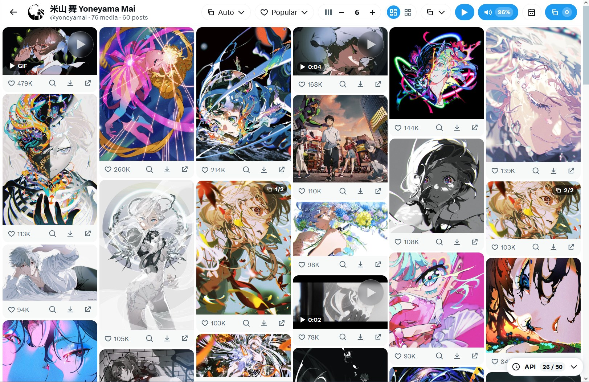
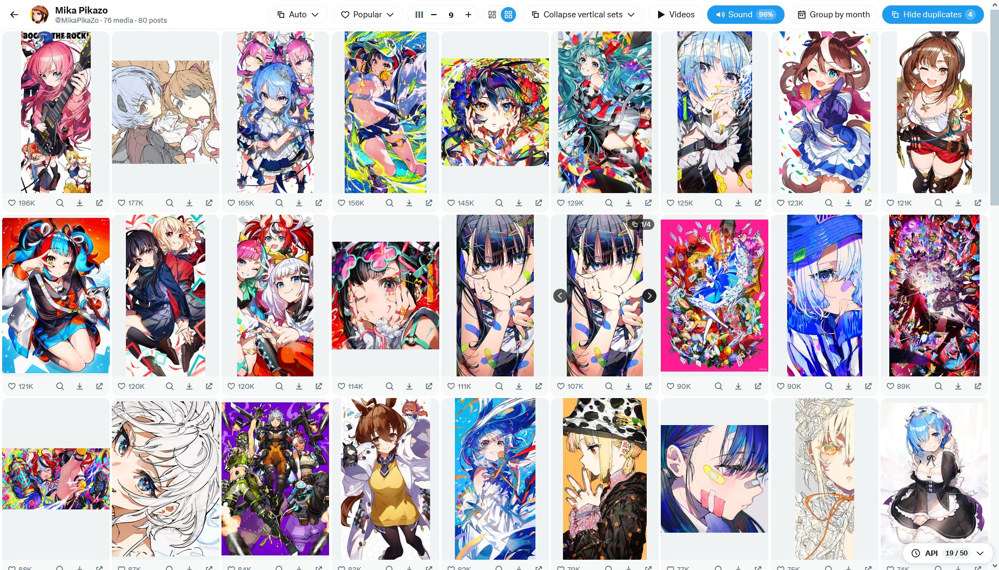
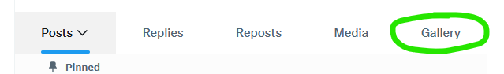

# X Gallery Mode

Userscript for x.com that adds a **Gallery** tab to every profile: all photos and videos of an account in one full-screen grid.

## Features

* Full-size photos and videos in a full-width grid
* Any number of columns
* Popular and Most recent sort orders
* Original quality downloads with dated file names
* Lightbox with keyboard and mouse wheel navigation
* Hover previews for videos with a seek bar
* Volume control
* Duplicate hiding
* Reply hiding with own threads kept
* Author's own posts only
* Reverse image search on IQDB in a background tab
* Multiple media per post as separate cards or a carousel
* Group by month
* Masonry or aligned rows
* Choice of data source: media or posts
* Native X look with theme colours
* English and Russian interface
* About dialog with the version, update date and repository links
* Automatic updates from this repository

The **Gallery** tab sits next to **Media** on every profile:

## Installation

1. Install a userscript manager: [Tampermonkey](https://www.tampermonkey.net/) or [Violentmonkey](https://violentmonkey.github.io/).
2. Open the install link <https://raw.githubusercontent.com/ImoutoChan/ImoutoXGalleryMode/master/x-gallery-mode.user.js> and confirm the installation (or open [`x-gallery-mode.user.js`](x-gallery-mode.user.js) from a local copy of this repository).
3. Visit any profile, e.g. <https://x.com/Annu_art_>, and click the **Gallery** tab.

Updates come on their own: the script carries `@updateURL` / `@downloadURL` pointing at this repository, so the userscript manager checks for a new version on its usual schedule (or right away through "Check for userscript updates").

You need to be logged in to X: the gallery uses the same internal GraphQL requests as the site itself, with your session.

The search button sends the "large" variant of the image to IQDB (`https://iqdb.org/?url=…`) through `GM_openInTab`, so the tab opens in the background and the gallery keeps focus; without `GM_openInTab` (e.g. when the script body is pasted into the console) a regular new tab opens.

For downloads in Tampermonkey it is worth enabling `Settings → Downloads BETA → Browser API`; otherwise the script downloads through a blob link (works too, but without the folder picker). Downloads always take the original: photos as `name=orig` in the format X stored them in (JPG or PNG), never a resized `small`/`medium`/`large` variant; videos and GIFs as the mp4 with the highest bitrate X offers. File name: `<handle>_<YYYYMMDD>_<post id>_<media index>.<jpg|png|mp4>`, e.g. `Annu_art__20260819_2096226125081104526_1.jpg` (the post date is local, as shown in the gallery).

## Details

- **Multiple media per post** — three modes in the menu with the stack icon: "Show all separately" (default), "Collapse vertical sets" and "Collapse all". Collapsing merges the attachments of one post into a carousel inside a single cell: arrows flip through the media, a click opens the current attachment in the lightbox, download applies to the current attachment. The first visible attachment sets the frame size, the others fit inside it. The vertical heuristic: a post has several attachments and each is at least 25% taller than it is wide. The mode persists and switches without reloading the feed; the video and duplicate filters keep working.
- **Data source** — "Auto", "Media" or "Posts" in the header. "Auto" keeps the original behaviour: Popular loads posts, Most recent loads media and falls back to posts when the first page is empty. An explicit choice disables the automatic switch. "Media" supports Most recent only; "Posts" supports both sort orders. The choice persists; changing it restarts loading. Only photos, videos and GIFs from posts end up in the gallery.
- **Whole images** — no cropping to squares, every picture keeps its aspect ratio (masonry layout).
- **Any number of columns** — from 1 (full-width picture in original quality) to as many as you like. `−` / `+` buttons, an input field, hotkeys `[` / `]` (or `-` / `=`).
- **Full window width** — the gallery opens on top of the page and takes the whole window instead of X's 600-pixel column.
- **Two layouts** — a switch in the header: "masonry" (cards pull up without gaps) or "aligned rows" (all cards of a row share the height of the tallest one, images fit inside, footers line up).
- **Group by month** — a header toggle: separators such as "September 2026 · 12 media", months from newest to oldest, the current sort order inside a month; the lightbox follows the on-screen order.
- **Videos and GIFs too** — the grid shows a poster with a ▶ badge and the duration (or "GIF"). Hovering a card plays the video muted in a loop; leaving the card stops it and brings the poster back. Videos load only on hover. A progress bar appears under a playing preview: click or drag it to seek. The lightbox has a player (GIFs loop silently), downloads take the best-bitrate mp4. The "Videos" toggle in the header hides them when you only want pictures. The "Sound" pill (off by default) opens a volume popover with a slider and a mute button; the level applies to previews and to the lightbox player, and changes made inside the player are remembered as well. GIFs are always silent.
- **Under every photo** — like count, date, a reverse image search button (IQDB, opens in a background tab), a button to download the original, a button to open the post in a new tab. Clicking a photo opens the lightbox (←/→ arrows or the mouse wheel flip photos, Esc closes; search, download and stats live there too: likes, reposts, views). The lightbox paints the variant already loaded for the grid at once and swaps in the large one when it arrives, so flipping never shows the previous photo while the next downloads; a small spinner in the corner shows while the sharper version or a video is still loading.
- **Duplicate hiding** — identical pictures posted several times collapse into one (the first in the current sort order stays). The comparison is perceptual: dHash + normalised correlation of 16×16 thumbnails, plus exact media key matches. The button shows how many are hidden; the toggle switches off with one click.
- **Replies** — a menu with the reply icon: "Show all" (default), "Own threads only" and "Hide all". "Own threads only" removes the posts the author wrote as replies to somebody else, which is what fills a media feed with reaction pictures, and keeps the replies written under their own posts, where a thread usually continues the same work. "Hide all" leaves originals alone. A reply is recognised by `in_reply_to_status_id_str` (with `conversation_id_str` as a fallback) and the addressee by `in_reply_to_user_id_str`, so no extra requests are needed. The mode persists and switches without reloading the feed; the pill tooltip shows how many media are hidden. Replies to other people come from the "Media" source only, "Posts" never returns them, while replies to one's own posts appear in both.
- **No reposts** — only the author's own posts are shown.
- **Sort orders** — "Popular" (X's native server-side sort by likes, paginated) and "Most recent". "Popular" opens by default.
- **Native design** — the tab is cloned from a real profile tab, the palette comes from the current X theme (Lights out / Dim / Default) together with the accent colour, Chirp font, the same radii, shadows and hover states as X. The header tools follow the profile name and wrap onto further lines only when they run out of room.
- Works on profile pages (`/name`, `/name/with_replies`, `/name/media` …), survives SPA navigation, remembers settings (columns, sort order, layout, grouping, sound and volume, the duplicates toggle, the replies mode). A URL with `#gallery` opens the gallery right away; the browser's Back button closes it.
- English or Russian interface depending on the X interface language.

## How it works

| What | Where from |
|---|---|
| User by handle | GraphQL `UserByScreenName` |
| "Popular" sort | GraphQL `UserOriginalsTimeline` with `sortByMostLiked: true` — the same request X makes when "Popular" is chosen on a profile; only posts with media are taken from the response |
| "Most recent" sort | GraphQL `UserMedia` — the source of the Media tab (photos and videos). For age-restricted (sensitive) accounts X returns it empty, so the gallery automatically falls back to the chronological `UserOriginalsTimeline` |
| Replies | `in_reply_to_status_id_str` and `in_reply_to_user_id_str` of the post, with `conversation_id_str` as a fallback when X stops sending them. `UserMedia` includes the replies the author wrote, `UserOriginalsTimeline` returns only their own posts and threads |
| Videos | The post's `video_info.variants`: the mp4 with the highest bitrate is used for playback and download, the poster is `media_url_https` with the same `name=…` sizes as photos |
| Query identifiers (`queryId`) | Read from X's main JS bundle (`main.*.js`) and cached per bundle version; when they go stale (HTTP 400/404) they are re-read automatically. The script ships fallback values. |
| Images | `pbs.twimg.com/media/<id>?format=<ext>&name=<small|medium|large|orig>` — the variant is picked for the column width and DPR; more columns means higher quality |

X's rate limiting (HTTP 429) is handled: the gallery shows a countdown and resumes on its own.

The bottom-right corner holds a panel with the last API response, collapsed by default. Its header reads `API · remaining / limit` (e.g. `API · 47 / 100`); unknown values are shown as `—`. Expanding it reveals the operation, HTTP status, response time, request limit, remaining requests, reset time and the raw `Retry-After`. A missing header is shown as "Not provided". For 429 the scheduled retry time is displayed as well: from `x-rate-limit-reset`, or 60 seconds later when no usable reset time exists. `Retry-After` is shown for diagnostics but does not change the delay. The panel reports responses to the script's own requests, not X's background requests.

## Development

One file, no dependencies. Syntax check: `node --check x-gallery-mode.user.js`. The version history lives in the comment right after the metadata block at the top of the script.

Tests for pagination, error handling and the video preview life cycle: `node --test tests/gallery.test.js`. The tests execute the script's code with stubbed API responses and never connect to X.

For one-off debugging you can paste the script body (without the `==UserScript==` header) into the console on a profile page — without `GM_*` the settings live in `localStorage` and styles are injected with a `<style>` tag.

## License

Copyright ImoutoChan, all rights reserved. Installing and using the script is allowed; redistribution and derivative works need the author's permission.
